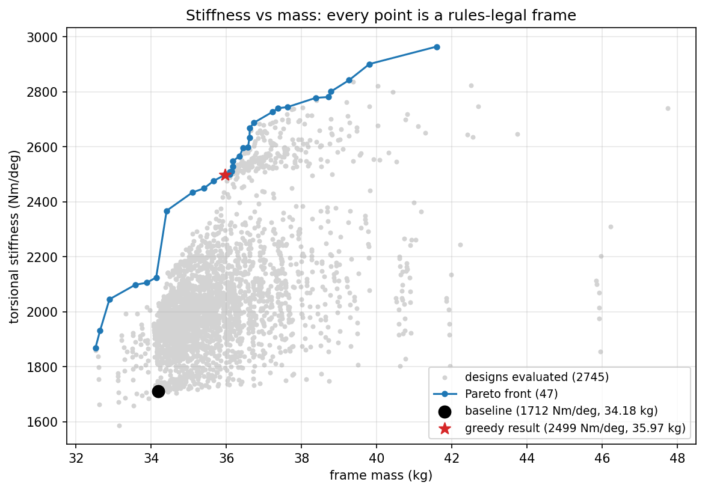

# Parametric FS spaceframe: generator, beam solver, and stiffness/mass optimisation

> Rules reference: **[Formula Student Rules 2026 v1.1](https://www.formulastudent.de/fileadmin/user_upload/all/2026/rules/FS-Rules_2026_v1.1.pdf)**, section T3 (General Chassis Design), with a few checks from T2 and T5. The clause numbers are listed in `spaceframe.py`.
> Verified against these sections only. See **Not modelled** below for what is out of scope.

*Personal project by Satt Gupta, developed summer 2026 and uploaded to GitHub in October 2026.*

A Formula Student steel spaceframe is generated from parameters under the T3
rules, analysed by a 3D beam finite-element solver written from scratch in
NumPy, and optimised for torsional stiffness per kilogram over a catalogue of
purchasable tubes.

| | Stiffness | Mass | Per kg |
|---|---|---|---|
| Baseline frame | 1712 Nm/deg | 34.18 kg | 50.1 |
| After dominance pass (stiffer, no heavier) | **1956 Nm/deg** | 34.08 kg | 57.4 |
| After greedy search, 2 kg budget | **2499 Nm/deg** | 35.97 kg | **69.5** |
| After greedy search, 4 kg budget | **3141 Nm/deg** | 38.06 kg | **82.5** |

Every design above is rules-legal, and worst buckling utilisation *falls* from
0.108 to 0.055 along the way: the stiffness is not bought by running members
closer to their limits.

**Headline deliverable:** `results/sensitivity_table.pdf` — one page, one row per
tube group, sorted by what a gram spent there buys.
**Case studies:** [`case_studies/CASE_STUDIES.md`](case_studies/CASE_STUDIES.md) —
four studies testing what the project claims, including a load-path failure, a
steel-vs-aluminium near-failure, and a comparison with published FS test data.



---

## Quick start

```bash
pip install -r requirements.txt

python spaceframe.py --out frames          # generate geometry -> frames/frame_at_node.json
python run_analysis.py frames/frame_at_node.json --buckling --energy
python run_sweep.py --max-tubes 0          # one-group-at-a-time sweep
python run_optimise.py --budget 2000       # combine changes, Pareto front
python make_report.py                      # the one-page PDF
python case_studies/run_case_studies.py    # numbers behind CASE_STUDIES.md

for f in tests/test_block*.py; do python $f; done     # 45 tests, or: pytest tests
```

Python 3.10+. NumPy and matplotlib; reportlab for the PDF; PyNite only for the
optional cross-check.

### Verify everything in one command

```bash
python verify.py            # tests, rules, regression pin
python verify.py --pynite   # also cross-check against a third-party solver
```

```
  VERIFICATION        RESULT           WHAT IT SHOWS
  -----------------------------------------------------------------------------------
  Test blocks         10/10 passed     closed-form beams, assembly, buckling, energy, sweep
  Rule checks         52/52 passed     T3 tube sizing and geometry, re-derived from coordinates
  Fuzzed frames       2000/2000 legal  random parameter sets, both pickup modes
  Baseline stiffness  1712.2 N.m/deg   regression pin 1712.2 OK
  Solve residual      1.3e-11          K u = F satisfied
  Support balance     5.7e-10          reactions equal applied load
  Energy balance      4.8e-13          strain energy = work done
  PyNite cross-check  1.0e-12          independent third-party solver, same frame

  ALL CHECKS PASSED in 15.9 s
```

Exit code 0 means everything passed.

---

## Pipeline

```
spaceframe.py      parameters -> rules-legal geometry
      |
      v  JSON (nodes, members with area/I/J, material, pickup nodes)
fesolver/          12x12 beam element per tube -> 216x216 global K -> solve K u = F
      |
      +-- run_analysis.py   torsion / bending / bulkhead, buckling, strain energy
      +-- run_sweep.py      one group at a time -> what each tube group buys
      +-- run_optimise.py   combined changes -> Pareto front
      +-- make_report.py    the one-page sensitivity PDF
```

---

## Part 1 — Generator (`spaceframe.py`)

36 nodes, 81 members, 34.18 kg, 52/52 rule checks passing, 18,000 random frames
legal across both pickup modes.

Three design decisions, each killing a class of bug rather than an instance:

1. **Geometry is built from positive gaps, not absolute stations.** "The main
   hoop is 650 mm behind the front hoop", never "the main hoop is at x=1420". A
   gap clamped positive makes ordering errors *unrepresentable*.
2. **`check()` never reads the parameters.** It sees only nodes and members and
   re-derives every quantity from coordinates, so it cannot merely confirm that
   the clamps ran.
3. **Tubes come from a catalogue of purchasable sizes**, and the legaliser picks
   the lightest one meeting the rule class.

Rules implemented: T3.2.1/T3.2.5 (wall, area, I by class), T3.8.3,
T3.9.2/T3.9.4, T3.10.3/T3.12.3, T3.11.2-T3.11.5, T3.12.1/T3.12.2, T3.14.1,
T3.15.1/T3.15.2, T3.17.7, T5.5.1/T5.5.2, T2.9.1/T2.9.2. Drops are measured to the
tube *surface*, not the centreline, as the rules require.

**Not modelled:** cockpit templates (T4.1, T4.2), Percy clearance (T4.3), roll
hoop bend geometry (T3.8.2, T3.9.3), SES approval. The hoops are sharp-cornered
polylines, not bent tubes. So: *rules-informed geometry, verified against T3* --
**not** *scrutineering-legal*.

**Load path.** The torsion load enters at the front axle station (x=300), not the
bulkhead plane, so the measurement spans the wheelbase and compares to published
figures. The axle station is triangulated; without it, ~44% of strain energy sat
in two 1.2 mm bulkhead-support tubes, which is a tube flexing, not a chassis
twisting.

**Pickup modes.** `at_node` (default) puts the load points on real frame nodes --
use this for the headline number. `mounted` hangs them on mount tubes;
stiffening only those tubes 10x changes the result by ~99%, so that mode largely
measures mounts, not the frame.

---

## Part 2 — Solver (`fesolver/`)

The whole method is one equation:

```
F = K u
```

`K` is built from tube geometry and steel properties, `F` is the applied load,
and `u` -- how far every node moves and rotates -- is what you solve for. Each of
the 36 nodes has 6 degrees of freedom, so `K` is 216x216. Each of the 81 tubes
contributes a 12x12 element matrix, rotated into car axes and added into `K` at
its two nodes' rows and columns.

Built in blocks, each with its own tests:

| Block | Code | Adds |
|---|---|---|
| 1 | `elements.beam2d_k` | 4x4 bending matrix |
| 2 | `assemble.py` | Assembly, supports, solve |
| 3 | `elements.frame2d_k` | Axial stiffness, rotation to any angle |
| 4 | `elements.frame3d_k` | 12x12: torsion `GJ/L`, bending in two planes, 3D rotation |
| 5 | `chassis.py` | JSON to model, torsion load case, Nm/deg |
| 6 | `loadcases.py` | Bending and bulkhead cases |
| 7 | `postprocess.py` | Member forces, Euler/Johnson buckling |
| 8 | `postprocess.py` | Strain energy breakdown |
| 9 | `sweep.py` | Candidate generation and evaluation |
| 10 | `optimise.py` | Combined changes, Pareto front |

### Why beam elements and not a truss

A truss idealisation (pin joints, axial force only) would be far simpler, and it
is wrong here. As pin-jointed bars this frame has ~21 mechanisms and a truss
solver gives a singular matrix. Measured on the real solution: **69 of 81 members
carry more bending stress than axial stress**, median bending-to-axial ratio 8.5.
Welded joints transfer moments, and the roll hoops are unbraced rectangles.

### Validation

1. **Closed-form beam solutions.** Blocks 1-4 check the element matrices against
   `PL^3/3EI`, `ML/EI`, `PL^3/48EI` and `TL/GJ`. For loads applied at nodes these
   are exact, not approximate, so agreement to ~1e-10 means correct, not close.
2. **PyNite cross-check.** The frame rebuilt in PyNite, a third-party
   open-source 3D frame solver with its own formulation: agreement to ~1e-12
   (`tools/crosscheck_pynite.py`). This is the strongest evidence here.
3. **Physical properties.** Mirror invariance, linearity, Maxwell-Betti
   reciprocity, support equilibrium, and total strain energy equal to the work
   done by the loads (~1e-13) -- checks that hold where no closed form exists.
4. **Regression pins.** Block 5 pins the frame at 1712.2 Nm/deg, and the same
   frame with its axle-station bracing removed at 953.9 Nm/deg, so any change in
   the solver's behaviour is caught immediately.

---

## Part 3 — Load cases and results

| Case | Applied | Supports | Result |
|---|---|---|---|
| Torsion | +/-500 N at the four front pickups (408.6 Nm) | 3 translations at the four rear pickups | 1712.2 Nm/deg |
| Bending | 80 kg driver + 70 kg powertrain at 1 g | vertical at four lower pickups, minimal lateral restraint | 0.043 mm sag, 33 914 N/mm |
| Bulkhead | 10 kN rearward on the IA mounting face | as torsion | 0.311 mm, 32 150 N/mm |

Twist is measured over the 408.6 mm lateral spacing of the loaded nodes, not the
track. Bending supports are deliberately minimal: fixing all translations at all
four corners would stop the frame stretching lengthways and invent stiffness that
is not there. The bulkhead case is a **stiffness metric for comparing designs**,
not a crash simulation.

### Strain energy — where the frame is actually flexing

`U = 0.5 u^T k u` per member, summing to the work done by the loads (checked
every run). Torsion case:

| Group | Share | Mass | Share per kg |
|---|---|---|---|
| REAR_IMPACT | 18.4% | 2.48 kg | 7.4 |
| MAIN_HOOP | 14.0% | 3.79 kg | 3.7 |
| MHB_SUPPORT | 8.3% | 2.05 kg | 4.0 |
| PICKUP_SUPPORT | 6.6% | 1.81 kg | 3.7 |
| SIS_LOWER | 6.5% | 1.22 kg | 5.3 |

A group holding 1% of the energy cannot buy more than 1% more stiffness however
much steel goes into it, so this ranks where stiffness is worth buying before any
search runs. The largest single displacement under torsion is 2.8 mm of **lateral
sway at the top of the main hoop** -- an unbraced rectangle racking into a
parallelogram, which no tube has to stretch for. A diagonal would stop it, which
the tube-size search cannot find because it is a geometry change.

### Buckling and stress

Slenderness `lam = kL/r`; **Euler** above the transition
`lam_c = sqrt(2 pi^2 E / Sy) ~ 148`, **Johnson parabola** below it, which blends
into yielding. `k = 1.0` (pinned) by default, conservative for welded joints.
Stress is checked as axial **plus bending** against welded yield (180 MPa), with
a linear beam-column interaction.

Worst utilisations on the baseline frame: buckling 0.108 (torsion), 0.206
(bulkhead); combined stress 0.219 (torsion), 0.485 (bulkhead). Every member of
this frame falls in the Johnson regime -- FS tubes are short and stocky, so
classic slender-column buckling never governs here; yielding at welds is nearer.

---

## Part 4 — Sweep and optimisation

**Sweep** (`run_sweep.py`) changes one group at a time and leaves the rest at
baseline, so the difference is attributable to that group alone. The generator is
imported as a module, so a candidate costs ~25 ms and never touches disk; ~1700
candidates run in 23 s and every one is re-checked against the rules.

**Free stiffness** -- stiffer for the same or less mass:

| Group | Change | Mass | Stiffness |
|---|---|---|---|
| MAIN_HOOP | 25x2.5 -> 30x2.0 | -17 g | **+100.4 Nm/deg** |
| PICKUP_SUPPORT | 25.4x1.6 -> 41.3x0.9 | -82 g | +56.8 Nm/deg |
| FRONT_HOOP / HARNESS_BAR | 25x2.5 -> 30x2.0 | ~0 | +35 / +36 Nm/deg |

Table 4 specifies minimum wall, area and second moment -- not a diameter -- so a
wider, thinner tube is legal, and `I` grows with OD^4 while mass grows with area.

**Optimisation** (`run_optimise.py`) combines changes and re-solves the full
frame each time, because changes are **not additive**: the harness bar upgrade is
worth +36 Nm/deg alone but +43 once the main hoop has been changed, since both
resist the same racking and stiffening one pushes more load through the other.

- *Dominance pass*: take every change that is stiffer and no heavier, repeat.
- *Greedy*: spend a mass budget, best Nm/deg per gram first, re-ranked after
  every accepted change.
- *Pareto front*: of everything evaluated, keep the designs nothing else beats on
  both mass and stiffness. `results/pareto.png`.

Greedy is not guaranteed to find the global optimum. It is transparent and
reproducible, which for 19 groups of catalogue tubes is the right trade; a GA
would be more machinery for a search this small.

`--min-wall 1.2` restricts the search to weldable walls: the rules set no minimum
wall for non-structural groups, so an unconstrained search will pick 0.9 mm walls
that are awkward to weld to a 2 mm hoop without burning through.

---

## Assumptions

Every result here rests on the assumptions below — the same ones a physical
torsion rig makes, plus a few modelling ones.

**Physics and loading**

- **A1 Static.** Loads are applied slowly and held. No inertia, vibration,
  damping or dynamic amplification.
- **A2 No aerodynamic loads.** Drag and downforce do not enter a static chassis
  test and are not applied. In service, aero downforce is a real extra load.
- **A3 No friction** at supports or joints.
- **A4 No tyres, springs, dampers or anti-roll bars.** The frame is loaded
  directly at its pickups, as on a torsion rig.
- **A5 Only the tubes carry load.** No stressed engine, seat or bodywork.
- **A6 Loads act only at nodes.** No distributed loads along tubes.
- **A7 Gravity ignored** in torsion and bulkhead cases; the bending case applies
  an 80 kg driver and 70 kg powertrain as point loads.

**Material**

- **A8 Linear elastic, isotropic steel:** E = 200 GPa, ν = 0.3, G = E/2(1+ν).
  No plasticity, so results above yield are not valid.
- **A9 Welded yield strength (180 MPa)** for all stress checks — members are
  weakest in the heat-affected zone by the joint.
- **A10 No residual weld stresses, corrosion, or wall/diameter tolerances.**

**Structural model**

- **A11 Small deflections.** Doubling the load exactly doubles every displacement.
- **A12 Euler–Bernoulli beams.** No shear deformation; less accurate for very
  short members.
- **A13 Rigid welded joints, modelled as points.** Tube diameter at a node, weld
  fillets and joint overlap are not modelled.
- **A14 Straight tubes between nodes.** Roll hoops are sharp-cornered
  polylines, not bent tubes.
- **A15 Round tubes,** so bending stiffness is the same in every direction.

**Supports**

- **A16 Torsion and bulkhead:** all three translations fixed at the four rear
  pickups, rotations free. Minimal supports read ~25% lower; not comparable.
- **A17 Bending:** vertical support at the four lower pickups plus minimum
  sideways restraint. Fixing more would invent stiffness.
- **A18 Supports are perfectly rigid.** A real rig flexes slightly.

**Failure checks**

- **A19 Member-by-member buckling** (Euler/Johnson, pinned ends — conservative
  for welded joints). No global buckling, no imperfections.
- **A20 No fatigue, crash loading, or joint and weld failure.**

**Rules and scope**

- **A21 Rules-informed, verified against T3** — not scrutineering-legal.
  Cockpit templates, Percy, hoop bend geometry and SES are not modelled.
- **A22 Node positions shift 1–6 mm during a sweep,** because rule caps are
  measured to the tube surface and depend on OD.
- **A23 No minimum wall for non-structural groups** in the rules; use
  `--min-wall 1.2` for a design meant to be welded.

---

## Limitations

Stated plainly, because knowing where the model stops is the point:

- Linear, static, small deflection. Euler-Bernoulli beams, no shear deformation.
- **Joints are points.** Tube diameter at a node is not modelled, so weld detail,
  joint overlap and fit-up are absent. This matters more as the optimiser picks
  larger tubes: a 44.5 mm tube meeting others at a node is not the same structure
  as a point connection.
- **Geometry is nearly, not exactly, fixed during a sweep.** Rule caps are
  measured to the tube surface, so changing an OD shifts a few brace attachment
  nodes by 1-6 mm. Every frame stays legal; the comparison is between legal
  frames, not between identical geometries.
- Member-by-member buckling from a linear solve. No global eigenvalue buckling,
  no imperfection sensitivity, no fatigue, no dynamic or crash loads.
- Node positions and topology are fixed, so the search cannot find geometry
  changes such as a hoop diagonal.
- Manufacturability is only guarded by `--min-wall`. Bend radii, stock
  availability and jigging are not modelled.
- Driver and powertrain mass locations in the bending case are packaging
  assumptions, set at the top of `loadcases.py`.

---

## Repo map

| Path | What it is |
|---|---|
| `spaceframe.py` | Parametric generator with the T3 rules baked in |
| `fesolver/elements.py` | Stiffness matrix of one tube: 4x4, 6x6, 12x12 |
| `fesolver/assemble.py` | Global `K`, supports, solve |
| `fesolver/chassis.py` | JSON to model; torsion load case |
| `fesolver/loadcases.py` | Bending and bulkhead load cases |
| `fesolver/postprocess.py` | Member forces and stresses, buckling, strain energy |
| `fesolver/sweep.py` | Candidate frames in memory, evaluation, CSV |
| `fesolver/optimise.py` | Dominance pass, greedy search, Pareto front |
| `run_analysis.py`, `run_sweep.py`, `run_optimise.py`, `make_report.py` | Entry points |
| `case_studies/` | Four case studies (`CASE_STUDIES.md`) and the script that produces their numbers |
| `tests/test_block1..10` | 45 tests, one file per build block |
| `verify.py` | One command that runs every check and prints one table |
| `tools/crosscheck_pynite.py` | Independent check against a third-party solver |
| `frames/` | Input geometry written by `spaceframe.py` |
| `results/` | Sensitivity PDF, Pareto plot and CSVs, deformed-shape plots |
| `docs/technical_report.pdf` | Three-page write-up: problem, method, validation, results, limitations |

Start reading at `tests/test_block1_single_beam.py` and work upward: each test
file states, as a hand-checkable formula, what the layer beneath it must do.

---